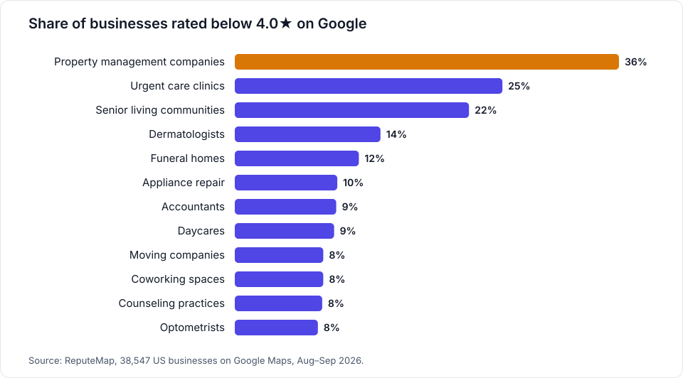
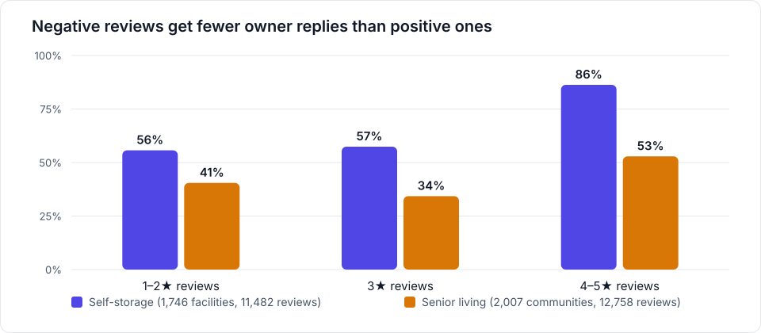

# Google Review Statistics 2026: Benchmarks by Industry

Original data from [ReputeMap](https://reputemap.com): Google ratings, review counts and owner reply
rates measured on public Google Maps listings, not taken from a survey. The study covers 38,547 US local
businesses in 50 industries and 103 cities, collected between August 23 and September 18, 2026. It gives
each industry's median Google rating, the share of businesses below 4.0★ and 4.5★, and review-count
percentiles. It also shows how often owners reply to their most visible reviews in self-storage
(1,746 facilities) and senior living (2,007 communities), split by star rating, operator type and metro area.
Every file here is an aggregate: no business names, addresses or review texts. The data is free to reuse
under [CC BY 4.0](LICENSE) with a link to the study page:
**https://reputemap.com/google-review-benchmarks**

## Key statistics

The same ten statistics, in the same words, lead the [study page](https://reputemap.com/google-review-benchmarks#key-statistics).
Each one has its own anchor there that you can link to.

1. **4.8★** median Google rating of a US local business (38,547 businesses in 50 industries and 103 cities). [#stat-median-rating](https://reputemap.com/google-review-benchmarks#stat-median-rating)
2. **92** median number of Google reviews per business. [#stat-median-reviews](https://reputemap.com/google-review-benchmarks#stat-median-reviews)
3. **7%** of businesses are rated below 4.0★; in 47 of 50 industries a 4.0★ rating sits in the bottom fifth. [#stat-below-4-stars](https://reputemap.com/google-review-benchmarks#stat-below-4-stars)
4. **36%** of property management companies are rated below 4.0★, the lowest-rated industry (median 4.3★). [#stat-lowest-rated-industry](https://reputemap.com/google-review-benchmarks#stat-lowest-rated-industry)
5. **408 vs 11** median Google reviews of a dentist vs a counseling practice, the widest gap between industries. [#stat-review-volume-gap](https://reputemap.com/google-review-benchmarks#stat-review-volume-gap)
6. **56%** of the most visible 1–2★ self-storage reviews carry an owner reply, against 86% of 4–5★ ones. [#stat-self-storage-negative-replies](https://reputemap.com/google-review-benchmarks#stat-self-storage-negative-replies)
7. **46%** of self-storage facilities showing a 1–2★ review leave at least one unanswered. [#stat-self-storage-unanswered](https://reputemap.com/google-review-benchmarks#stat-self-storage-unanswered)
8. **92% vs 70%** owner reply rate of brand-name self-storage operators vs independents, on their most visible reviews. [#stat-self-storage-brands](https://reputemap.com/google-review-benchmarks#stat-self-storage-brands)
9. **36%** of senior living communities replied to none of their most visible reviews (51% of those reviews carry a reply). [#stat-senior-living-no-replies](https://reputemap.com/google-review-benchmarks#stat-senior-living-no-replies)
10. **3.1 days** median wait for an owner reply to a 1–2★ senior living review, against 1.1 days for a 4–5★ one. [#stat-senior-living-reply-time](https://reputemap.com/google-review-benchmarks#stat-senior-living-reply-time)

The page rounds percentages to whole numbers. The CSV files keep one decimal (for example 6.5% below
4.0★, shown as 7%).

## Charts

## Files

| File | Rows | What it holds |
|---|---|---|
| [`data/google-review-benchmarks-2026.csv`](data/google-review-benchmarks-2026.csv) | 50 | One row per industry: businesses, cities, median rating, share below 4.0★ and 4.5★, review-count percentiles, and the Google Maps search behind the row. Byte-for-byte the CSV published at [reputemap.com/data/google-review-benchmarks-2026.csv](https://reputemap.com/data/google-review-benchmarks-2026.csv). |
| [`data/overall-2026.csv`](data/overall-2026.csv) | 1 | All 50 industries together: the median rating, median review count and shares below 4.0★ and 4.5★ behind key statistics 1–3. |
| [`data/owner-replies-2026.csv`](data/owner-replies-2026.csv) | 8 | Owner replies to the most visible reviews: self-storage (all, brand-name, independent), senior living (all), assisted living and retirement communities (all, brand-name, independent) and nursing homes. |
| [`data/senior-living-by-metro-2026.csv`](data/senior-living-by-metro-2026.csv) | 17 | Assisted living and retirement communities by metro area (metros with 40+ communities), sorted by reply rate. |
| [`data/property-managers-by-city-2026.csv`](data/property-managers-by-city-2026.csv) | 37 | Property management companies by city (cities with 20+ companies), sorted by the share rated below 4.0★. |
| [`charts/share-below-4-stars-by-industry.svg`](charts/share-below-4-stars-by-industry.svg) | | The 12 industries with the largest share of businesses below 4.0★. |
| [`charts/owner-reply-rate-by-star-rating.svg`](charts/owner-reply-rate-by-star-rating.svg) | | Owner reply rate by star rating, self-storage vs senior living. |

Every number in these files is copied from the data behind the live page, not recalculated for this
repository. The page, its tables, its FAQ and this repository all show the same figures.

## Method

**Who is in the data.** We searched Google Maps for one term per industry (for example "dentist",
"self storage", "property management") in 103 large and mid-size US cities between August 23 and
September 18, 2026. We kept every listing with at least one review. An industry appears only if it has
200 or more businesses. Each industry covers between 8 and 45 cities. A business is counted once, in the
first industry search that found it. The `google_maps_search` column gives the exact search behind each
row.

**Ratings and review counts** are the values Google showed on each listing at collection time. Medians
are rounded to one decimal (ratings) or to a whole number (review counts). Percentiles use the nearest
rank: the value at position round(p × (n − 1)) in the sorted list.

**Owner replies.** For self-storage and senior living we read the reviews Google lists first on each
listing (up to 8, in Google's "most relevant" order). A review counts as answered if it shows an owner
response. Reply time is the gap between the review's date and the response's date as Google publishes
them. Because "most relevant" is Google's own ordering, these rates describe what a prospect sees first,
not every review a business has.

**Brand-name vs independent operators.** A listing counts as brand-name when its name contains one of 21
self-storage operator names or one of 25 senior living operator names. The lists are printed in the
[method section of the study page](https://reputemap.com/google-review-benchmarks#method). They are left
out of this repository so that it holds no business names.

**Deep dives (added October 9, 2026).** These use the same collection and the same reply rules.
"Assisted living and retirement communities" are the senior living listings whose Google category is
Aged care, Assisted living facility, Retirement community or Retirement home. Nursing homes are counted
separately. Home care agencies and senior apartments are left out. A metro area is the city searched,
and a metro appears only with 40+ communities. Property managers by city use the same 1,802 companies
as the industry table, shown for cities with 20+ companies.

## Caveats

- **Not a random sample.** The sample is Google Maps search results for "industry + city" in 103 cities.
  Google returns established listings in larger cities first. Small towns and very new businesses are
  under-represented, and ratings may read slightly high.
- **Up to 8 "most relevant" reviews per business.** Reply rates describe the reviews Google shows first,
  not a business's full review history.
- **A snapshot.** Ratings, review counts and replies were collected August 23 – September 18, 2026, and
  they change every day.
- **Small groups.** Metro rows rest on tens of communities, and the brand-name senior living group has 115.
  Read their percentages as indications, not precise rates.
- **Two passes over senior living.** The industry table (2,004 communities) and the reply study (2,007)
  come from separate passes over listing and review data, so their counts differ slightly.
- **Aggregates only.** No business names, addresses, reviewer names or review texts are published.
- ReputeMap is not affiliated with or endorsed by Google.

## How to cite

> ReputeMap (2026). *Google Review Statistics 2026: Benchmarks by Industry* [Data set].
> https://reputemap.com/google-review-benchmarks

Please link to the study page, or to the anchor of the statistic you quote (for example
`https://reputemap.com/google-review-benchmarks#stat-self-storage-negative-replies`). Every industry row has
its own anchor too, e.g. `#industry-dental`. GitHub's "Cite this repository" button reads
[`CITATION.cff`](CITATION.cff). The study was first published as *Google Review Benchmarks by Industry (2026)*,
and citations under that name refer to the same data.

## License

The data and charts are licensed under [Creative Commons Attribution 4.0 International (CC BY 4.0)](LICENSE).
You may share and adapt them for any purpose, commercial included, as long as you credit
"ReputeMap" and link to https://reputemap.com/google-review-benchmarks.

## Data dictionary

Percentages run from 0 to 100 with one decimal. An empty cell means the measure was not computed for that
row.

### `data/google-review-benchmarks-2026.csv`

| Column | Type | Meaning |
|---|---|---|
| `industry` | text | Industry label used on the study page |
| `google_maps_search` | text | The Google Maps search term(s) that found the businesses in this row |
| `businesses` | integer | Listings with at least one review |
| `cities` | integer | Cities (city + state) where the row's businesses were found |
| `median_rating` | number | Median Google star rating, one decimal |
| `pct_below_4_0` | percent | Share of businesses rated below 4.0★ |
| `pct_below_4_5` | percent | Share of businesses rated below 4.5★ |
| `median_reviews` | integer | Median number of Google reviews |
| `p25_reviews` | integer | 25th percentile of the review count |
| `p75_reviews` | integer | 75th percentile of the review count ("top quarter has" on the page) |
| `p90_reviews` | integer | 90th percentile of the review count |

### `data/overall-2026.csv`

| Column | Type | Meaning |
|---|---|---|
| `scope` | text | `All industries`: every business in the 50 industries above |
| `businesses` | integer | Businesses in the 50 industries |
| `industries` | integer | Industries with 200+ businesses |
| `cities` | integer | Cities (city + state) in the collection |
| `median_rating` | number | Median Google rating across all businesses |
| `median_reviews` | integer | Median number of Google reviews across all businesses |
| `pct_below_4_0` | percent | Share of all businesses rated below 4.0★ |
| `pct_below_4_5` | percent | Share of all businesses rated below 4.5★ |
| `collected_from` | date | First day of collection (YYYY-MM-DD) |
| `collected_to` | date | Last day of collection (YYYY-MM-DD) |

### `data/owner-replies-2026.csv`

| Column | Type | Meaning |
|---|---|---|
| `segment` | text | `self_storage`; `senior_living` (all senior living listings); `assisted_living_and_retirement` and `nursing_homes` (subsets of senior living, by Google category) |
| `operator_group` | text | `all`, `brand_name` (name contains a national or regional operator name) or `independent` |
| `businesses` | integer | Listings with at least one sampled review |
| `reviews_sampled` | integer | Reviews read: up to 8 "most relevant" per listing |
| `pct_reviews_replied` | percent | Share of sampled reviews that show an owner reply |
| `reviews_sampled_1_2_star` | integer | Sampled reviews rated 1 or 2 stars |
| `pct_1_2_star_replied` | percent | Share of sampled 1–2★ reviews with an owner reply |
| `reviews_sampled_3_star` | integer | Sampled reviews rated 3 stars |
| `pct_3_star_replied` | percent | Share of sampled 3★ reviews with an owner reply |
| `reviews_sampled_4_5_star` | integer | Sampled reviews rated 4 or 5 stars |
| `pct_4_5_star_replied` | percent | Share of sampled 4–5★ reviews with an owner reply |
| `pct_businesses_no_replies` | percent | Share of listings with no owner reply on any sampled review |
| `businesses_showing_1_2_star` | integer | Listings with at least one sampled 1–2★ review |
| `pct_left_1_2_star_unanswered` | percent | Of those listings, the share that left at least one sampled 1–2★ review unanswered |
| `median_days_to_reply_1_2_star` | number | Median days from a 1–2★ review to its owner reply (answered reviews only) |
| `median_days_to_reply_4_5_star` | number | Median days from a 4–5★ review to its owner reply (answered reviews only) |
| `pct_1_2_star_replies_within_1_day` | percent | Of the answered 1–2★ reviews, the share answered within 1 day |
| `pct_1_2_star_replies_within_7_days` | percent | Of the answered 1–2★ reviews, the share answered within 7 days |
| `pct_1_2_star_replies_after_7_days` | percent | Of the answered 1–2★ reviews, the share answered more than 7 days later |
| `pct_all_reviews_1_2_star` | percent | Share of all of the listings' reviews (Google's per-star totals, not just the sample) that are 1–2★ |
| `median_rating` | number | Median Google rating of the listings in the group |
| `pct_rated_below_4_0` | percent | Share of the listings in the group rated below 4.0★ |

The `brand_name` and `independent` rows for self-storage carry only the counts and the overall reply rate.

### `data/senior-living-by-metro-2026.csv`

Assisted living and retirement communities only (not nursing homes). The columns have the same meaning
as in `owner-replies-2026.csv`.

| Column | Type | Meaning |
|---|---|---|
| `metro` | text | City searched, with state |
| `communities` | integer | Communities with at least one sampled review |
| `reviews_sampled` | integer | Reviews read: up to 8 "most relevant" per community |
| `pct_reviews_replied` | percent | Share of sampled reviews with an owner reply |
| `reviews_sampled_1_2_star` | integer | Sampled 1–2★ reviews |
| `pct_1_2_star_replied` | percent | Share of sampled 1–2★ reviews with an owner reply |
| `pct_businesses_no_replies` | percent | Share of communities with no owner reply on any sampled review |
| `businesses_showing_1_2_star` | integer | Communities with at least one sampled 1–2★ review |
| `pct_left_1_2_star_unanswered` | percent | Of those, the share that left at least one sampled 1–2★ review unanswered |
| `median_days_to_reply_1_2_star` | number | Median days from a 1–2★ review to its owner reply |
| `median_days_to_reply_4_5_star` | number | Median days from a 4–5★ review to its owner reply |
| `pct_1_2_star_replies_after_7_days` | percent | Of the answered 1–2★ reviews, the share answered more than 7 days later |
| `median_rating` | number | Median Google rating of the communities |
| `pct_rated_below_4_0` | percent | Share of the communities rated below 4.0★ |

### `data/property-managers-by-city-2026.csv`

| Column | Type | Meaning |
|---|---|---|
| `city` | text | City searched, with state |
| `companies` | integer | Property management companies with at least one review |
| `median_rating` | number | Median Google rating. With an even number of companies the median can fall between two ratings (for example 3.85); the page rounds it to one decimal |
| `pct_rated_below_4_0` | percent | Share of companies rated below 4.0★ |

## Versions

- **1.0** (October 1, 2026): industry table and the self-storage and senior living reply study.
- **1.1** (October 9, 2026): senior living deep dive (operator type, nursing homes, metro areas) and
  property managers by city.

## About

[ReputeMap](https://reputemap.com) is Google review management software for multi-location businesses
and agencies. Questions about the data: [reputemap.com/contact](https://reputemap.com/contact).
